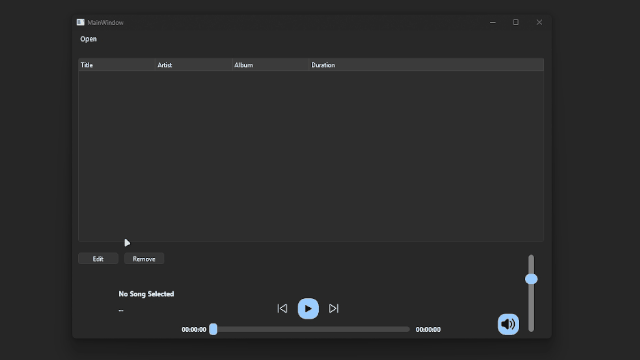
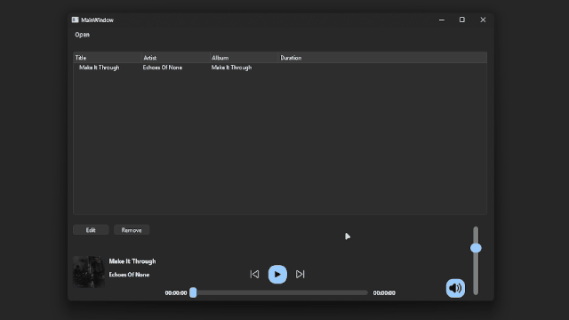

# Media Player (Mar 30, 2026)
A custom media player built from scratch in C++ using Qt. It allows users to import MP3 files, manage track metadata (artist, song name, album, and cover art), and organize them into custom playlists.

## Features
- **Import & Metadata:** Add MP3 files and specify or view track details (artist, title, album, cover art).
- **Playlist Management:** Automatically organizes imported files into a playable queue.
- **Playback Controls:** Play, pause, skip to the next/previous track, and toggle shuffle mode.

## Preview
| 1. Add a New Song | 2. Play a Song |
| :---: | :---: |
|  | 

## Watch the Video
You can watch a devlog/video I made about this project (in French):
[Watch on YouTube](https://youtu.be/76g6QEE7_yM?si=fN6qPx7Spqb1l2n0)

## Download & Source Code
- **Build:** You can test the application by downloading the `MediaPlayerBuild` folder.
- **Source Code:** The `MediaPlayerProject` folder contains the Qt project files (built with Qt version 6.0.2).
